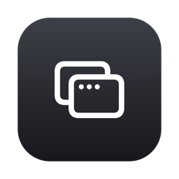
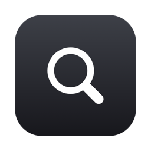
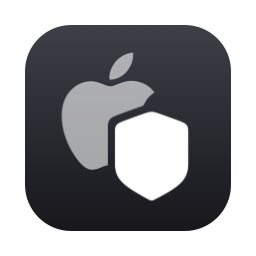
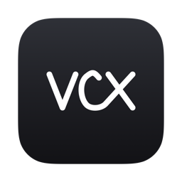
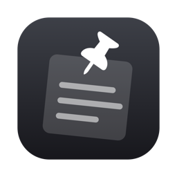
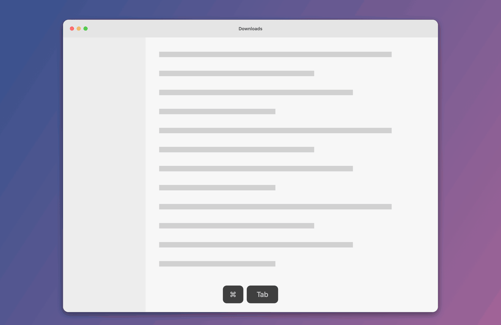
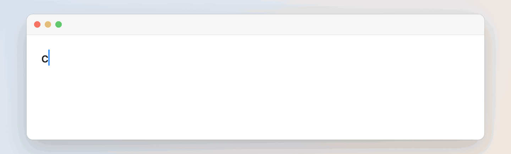
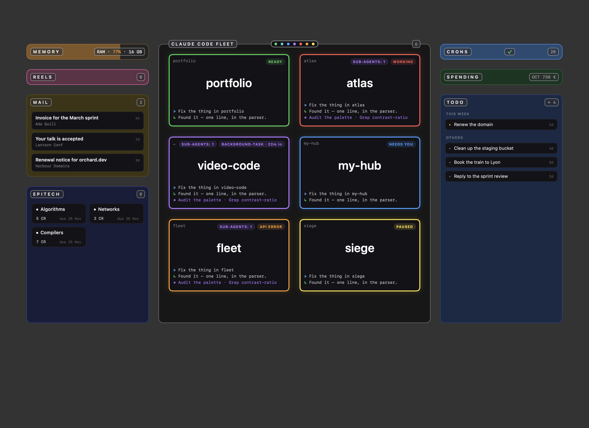
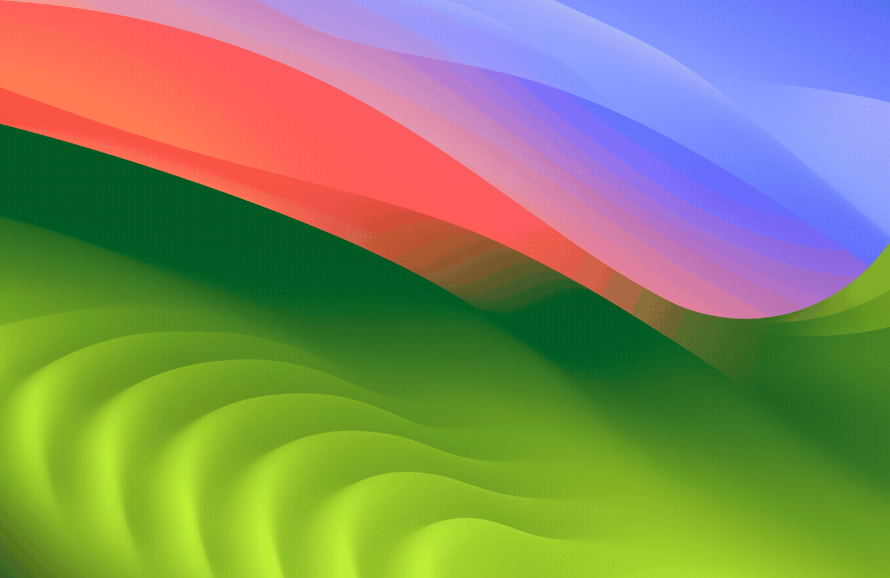

# my-apps

Little apps made for my needs. Each one is a folder at the root of this repo, and each one
runs on my Mac today.

Fleet and Vibe Code X are in [fleet](fleet) and [vcx](vcx).

<!-- apps:start -->
#### macOS apps, reworked for my needs

| | App | What it does |
|:-:|---|---|
|  | [alt-tab](alt-tab) | The ⌘Tab switcher, one tile per window with its picture. |
|  | [opener](opener) | Spotlight for apps only, on ⌘Space. |
|  | [screenshot](screenshot) | A ⌘⇧5 replacement whose file is on disk the moment you click. |

#### My own apps

| | App | What it does |
|:-:|---|---|
|  | [autocorrect](autocorrect) | Fixes the word you just typed, in French and in English. |
|  | [fleet](fleet) | Every Claude Code session on the Mac, and which ones need you. |
|  | [mac-guard](mac-guard) | Stops the processes that take the Mac down. |
|  | [vcx](vcx) | Vibe Code X: a native window for Claude Code, Codex and Qwen. |
|  | [watcher](watcher) | The answers you are waiting for, one at a time, on ⌘⌥K. |

### [alt-tab](alt-tab)

### [autocorrect](autocorrect)

### [fleet](fleet)

### [mac-guard](mac-guard)

### [opener](opener)

### [screenshot](screenshot)

### [vcx](vcx)

### [watcher](watcher)

<!-- apps:end -->
