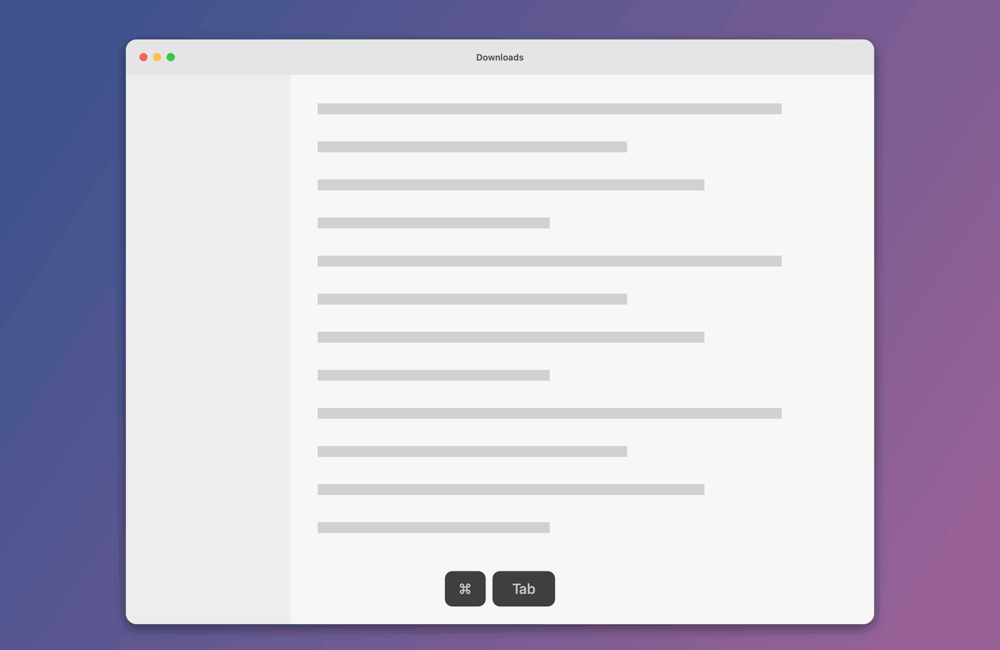
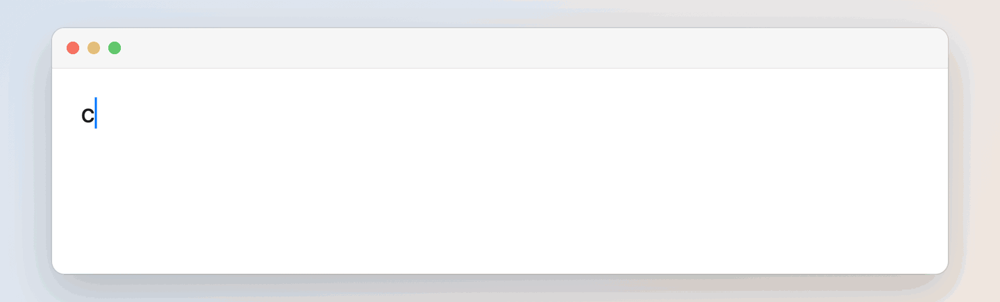
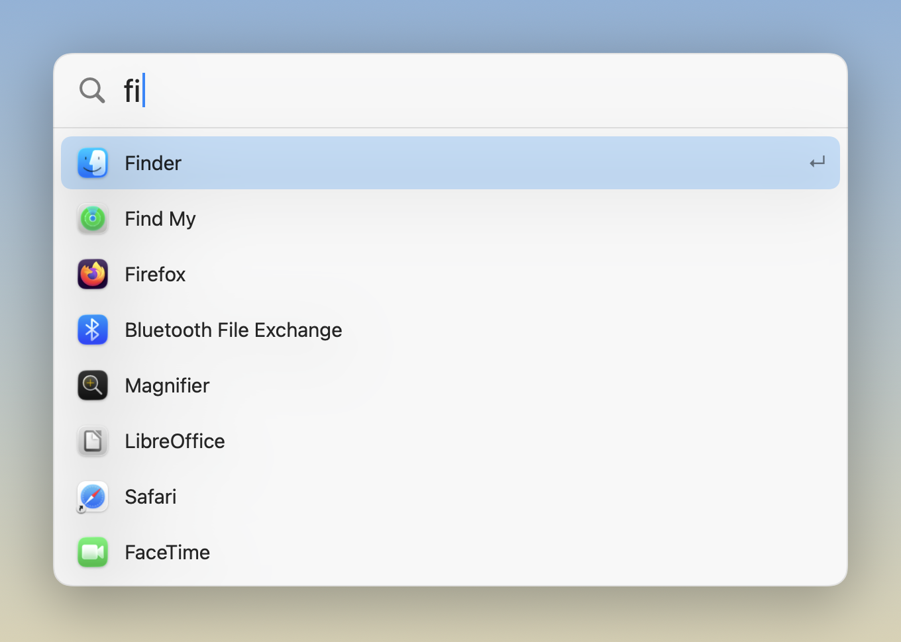
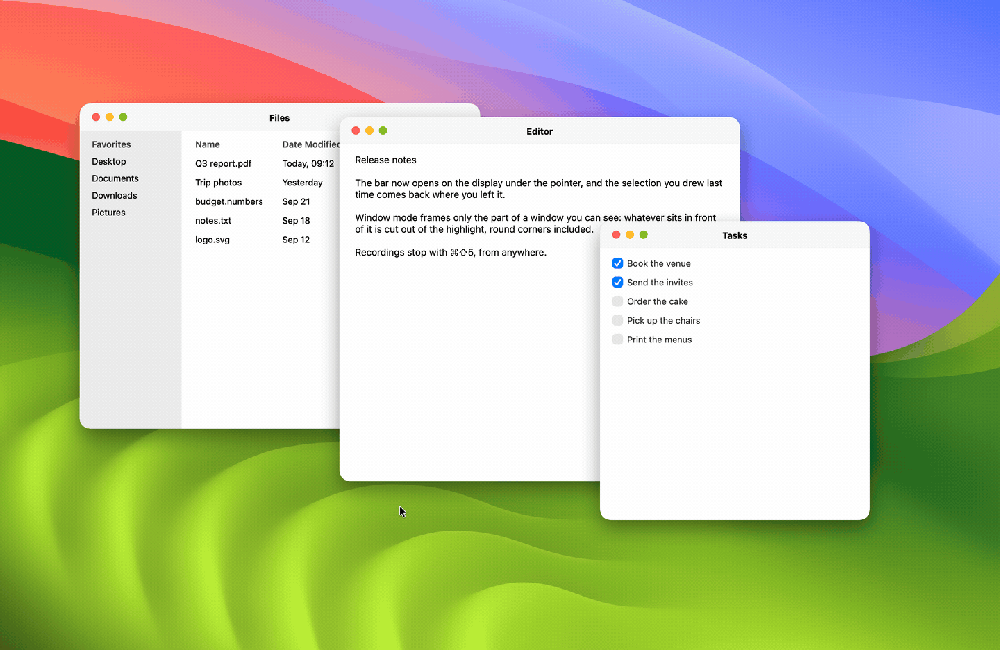
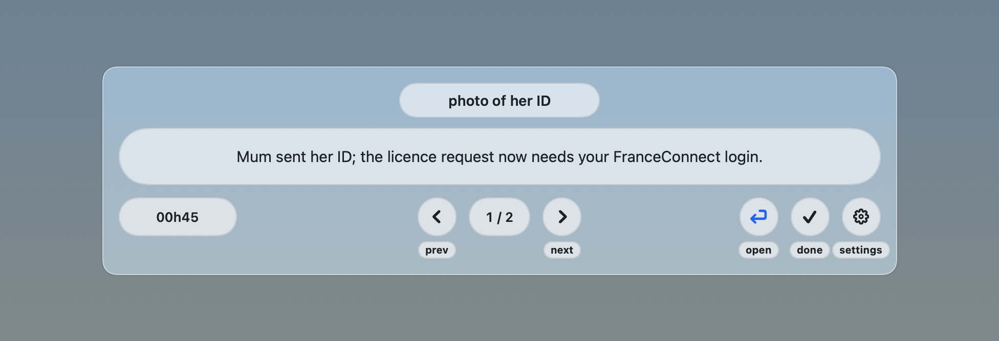

# my-lab

Little apps made for my needs. Each one is a folder at the root of this repo, and each one
runs on my Mac today.

## Using one

```sh
git clone https://github.com/anpawo/my-lab.git && cd my-lab/<app>
./install.sh
```

`install.sh` builds the app, copies it to `~/Applications` and registers a launchd agent so it
starts with your session. All it needs is a Swift toolchain and the Command Line Tools, no
Xcode. Written for macOS on Apple Silicon. MIT, see [`LICENSE`](LICENSE).

Or download it: [the latest release](https://github.com/anpawo/my-lab/releases/latest) has every app,
zipped, rebuilt on each change.

**If you took one home, leave a star.** It is the only signal I get that any of this was
useful to someone else.

## The apps

Click one for its README.

<!-- apps:start -->
### [alt-tab](alt-tab)

[](alt-tab)

### [autocorrect](autocorrect)

[](autocorrect)

### [opener](opener)

[](opener)

### [screenshot](screenshot)

[](screenshot)

### [watcher](watcher)

[](watcher)
<!-- apps:end -->
