# my-apps

Little apps made for my needs. Each one is a folder at the root of this repo, and each one
runs on my Mac today.

Every app, built: [latest release](https://github.com/anpawo/my-apps/releases/latest).

<!-- apps:start -->
#### macOS apps, reworked for my needs

| | App | What it does |
|:-:|---|---|
| 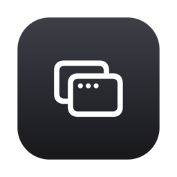 | [alt-tab](alt-tab) | The ⌘Tab switcher, one tile per window (its screenshot, no Finder). |
| 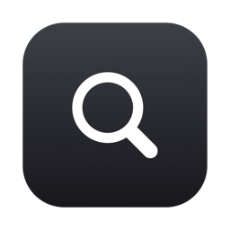 | [opener](opener) | Spotlight for apps only, on ⌘Space (no constant indexing of my files). |
|  | [screenshot](screenshot) | A ⌘⇧5 replacement (copied + saved, pinned a few sec in the top right corner). |

#### My own apps

| | App | What it does |
|:-:|---|---|
|  | [autocorrect](autocorrect) | Fixes the word you just typed, in French and in English. |
| 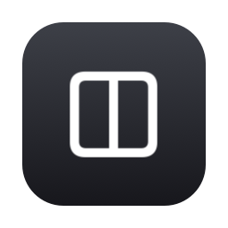 | [desks](desks) | Desktops without the slide: go there at once, carry a window, from a hotkey. |
|  | [fleet](fleet) | Every Claude Code session on the Mac, and which ones need you. |
| 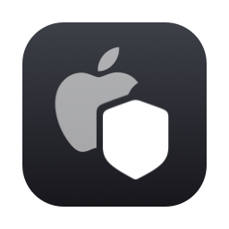 | [mac-guard](mac-guard) | Stops the processes that take the Mac down. |
| 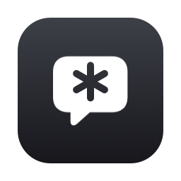 | [one-text](one-text) | One conversation per person, across WhatsApp, Instagram, Discord and more. |
|  | [vcx](vcx) | Vibe Code X: a native window for Claude Code, Codex, Qwen and more... |
|  | [viewer-media](viewer-media) | Images, videos, GIFs, music and PDFs in one window, arrows to switch and change speed. |
| 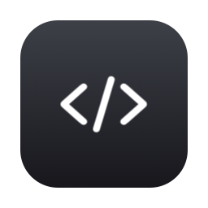 | [viewer-text](viewer-text) | A minimal viewer and editor for text and code, with coloring. |
| 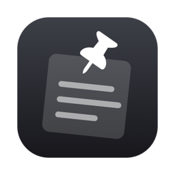 | [watcher](watcher) | Watches what you are waiting for: mail answers, PR reviews and more... |

### [alt-tab](alt-tab)

### [autocorrect](autocorrect)

[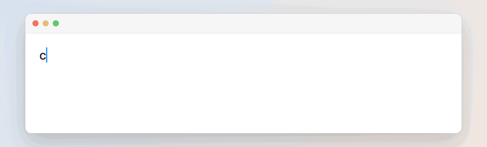](autocorrect)

### [desks](desks)

### [fleet](fleet)

[![A bare desktop, then Fleet's panel after 45 s idle or ⌘⌥L: ten sessions in project groups (portfolio, atlas, video-code, my-hub, then fleet and siege on a second desktop under a rule), each card coloured by its state, between MEMORY, DISK and MONEY on the left and MAIL, TODO and MESSAGES on the right; atlas finishes its turn and turns green, portfolio asks a question and turns blue, then each side block unfolds in turn: MEMORY's kernel, GPU and top apps, the folders DISK saw grow, MONEY's accounts and spending pie, MAIL with a starred sender first, the TODO list and unread chats, and esc brings the desktop back](fleet/docs/demo.gif)](fleet)

### [mac-guard](mac-guard)

### [one-text](one-text)

[![A walk through One Text on made-up chats: favorites on top (Lea Martin, Chloe Dubois, Mom, the Climbing crew group chat) under the Friends, Family and Work groups, a list where each picture carries its app's logo and unread counts; Lea's Instagram and WhatsApp messages in one thread with a reel card, a photo, a reply quote and reactions, a heart added from the hover bar and a reply sent; Friends unfolded and the Flat 4B group chat dragged into it; tom's Discord thread with a voice message, a code block and a list, and a deleted message kept dimmed; the ⌘D search opening Hugo R and the menu under his name with a Split row per app; then Settings with the Play reels here switch and every shortcut](one-text/docs/demo.gif)](one-text)

### [opener](opener)

[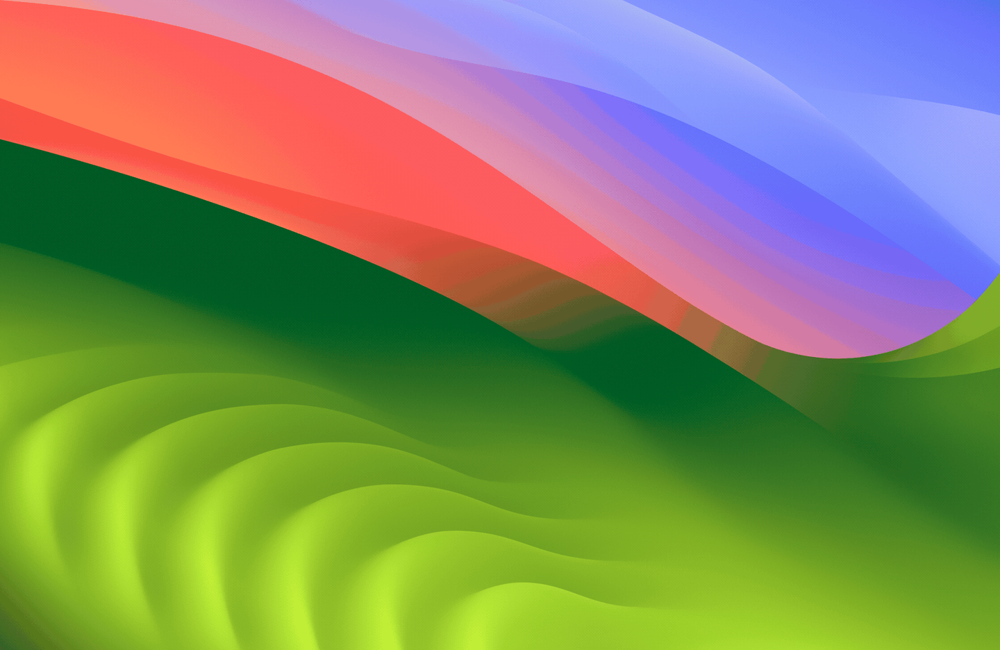](opener)

### [screenshot](screenshot)

### [vcx](vcx)

### [viewer-media](viewer-media)

[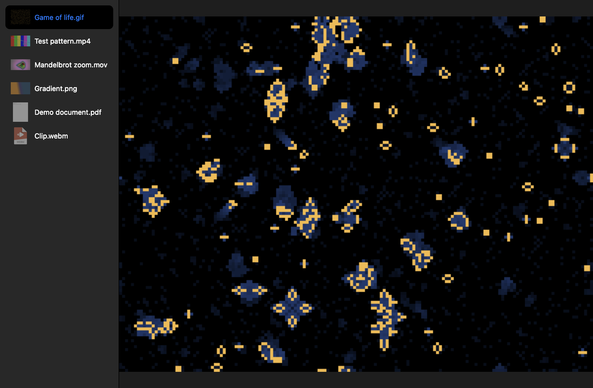](viewer-media)

### [viewer-text](viewer-text)

[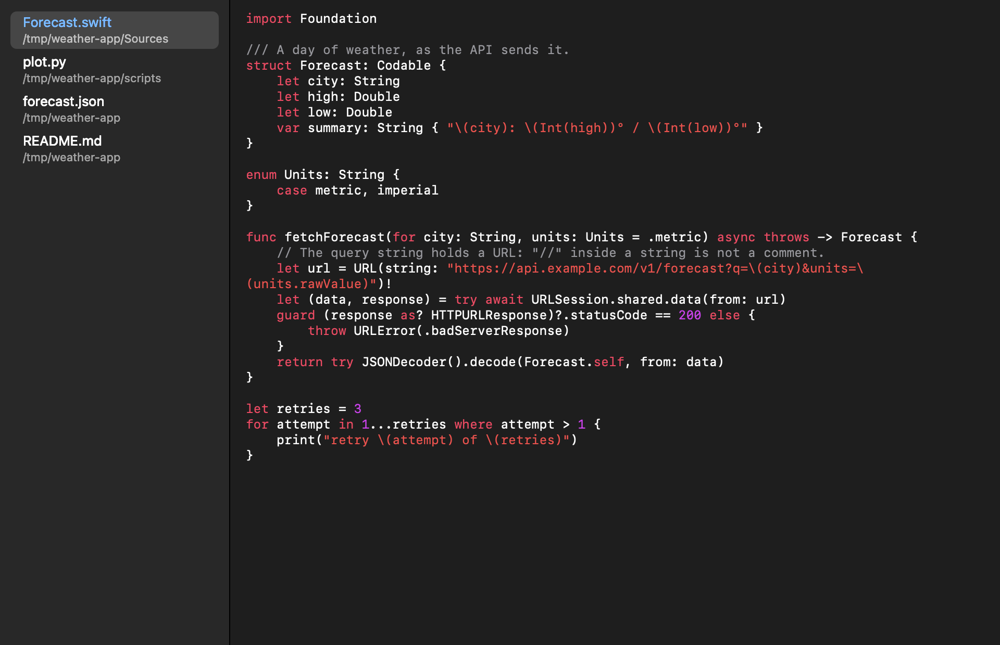](viewer-text)

### [watcher](watcher)

<!-- apps:end -->
