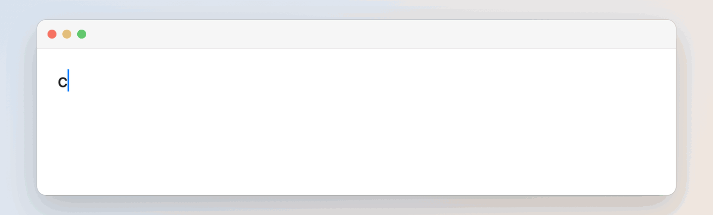

# autocorrect

Fixes the word you just typed when you press space, in French and in English, in every app. Mostly the
accents and apostrophes a U.S. keyboard makes you leave out: `ca va tres bien` becomes `ça va très bien`,
`cest` `c'est`, `peutetre` `peut-être`, `dont` `don't`, `teh` `the`. No underline, no popup: the word is
replaced as you go.



| Key | Does |
|---|---|
| space, ↵ | fix the word before it, with its punctuation (`tres!` → `très!`) |
| `.` `,` | fix the word before it at once (`tres,` → `très,`); a letter right after puts it back (`etudiant.gouv.fr`) |
| ⌫ right after | put back what you typed; that fix waits ten minutes, then comes back a little weaker |

## How it picks

Each spelling the word could be gets a score: how often it is said (French and English counts, weighed by
how French the sentence is so far, plus how often you use it) times how likely you typed it that way when you
meant it (as is, without its accents or apostrophe, one letter off, two pairs swapped). A typo of two letters swapped
counts most, then a key next to the right one, then a farther slip: `wnat` is not made `what`. The best one replaces the word only when
it scores five times higher, and three times higher than the next best: `verifie` could be `vérifie` or
`vérifié`, so it is left as typed. The word right before counts too, for typos (`i wnat` is `i want`)
and between spellings of one word:
`j'ai verifie` becomes `j'ai vérifié`, `il verifie` `il vérifie`, `je vais a` `je vais à` while `il a`
stays. Mixed sentences work: `dont` is `don't` after `i`, and stays `dont` after
`la maison`. A missed space is put back when no dictionary knows the word and the two halves are often
said together: `isthe` becomes `is the`, `jesuis` `je suis`. A space typed inside a word is taken out when
neither half is a word: `infor mation` becomes `information`.

A real word is changed only once the next one is typed, when the words on both sides make another
spelling a hundred times likelier: `il et parti` becomes `il est parti`, `their is` `there is`, `ils son
partis` `ils sont partis`. A noun takes the number of the word before it: `des enfant` becomes `des
enfants`, and a French verb the ending the word before it calls for: `j'ai manger` becomes `j'ai mangé`,
`je vais mangé` `je vais manger`. `courte et évidente` stays, and `ses` is never made `ces`. On 47,000 words of clean English and
French it changes nothing.

It never changes a word it knows into another one (`chat`, `scan` stay), a word typed with its accents
(`côte` stays), nor a word the macOS spell checker knows (`plugin`, `hotkey`, `tutoriels`). A typo is not made into a
rare word you never type (`aveen` is not `aven`), a rude one, a word with accents French lacks or that the French
dictionary does not take (`theyâ`), nor an English word after `d'` or `l'` (`dand` is `dans`, not `d'and`). It leaves alone
words with a digit or a capital inside (`GitHub`), links and addresses (`etudiant.gouv.fr`), a word begun
after an arrow key (it sees keys, not the text), password fields, and terminals (but
Ghostty, where Claude Code runs), code editors and password managers (the list is in
`Sources/autocorrect/Tap.swift`). Another app:

```sh
defaults write com.mr.autocorrect skip -array-add <bundle id> && launchctl kickstart -k gui/$UID/app.autocorrect
```

## What it learns

`~/Library/Application Support/autocorrect/learned.json`, readable by you alone: how often you kept each
word, the fixes you took back with ⌫, and the ones you let stand. A word you kept is never fixed as a typo
again, a fix you took back waits ten minutes and weighs a little less after, and among close spellings the one you use wins.

Once a day it has Claude (`~/.local/bin/claude -p`, Opus, no tools) read what it learned since the last
time and take the mistakes out: a typo you left, which then counts as your word; a fix you let stand and put
right by hand later (`eip` made `épi`); a ⌫ that took back a right fix. What it changed, and why, goes to
`review.log` beside `learned.json`. `autocorrect --review` says what a review would change now, and writes
nothing.

Words you already use elsewhere can be given to it ahead of time: a `seed.tsv` (word, tab, how many times)
put beside `learned.json` is taken in within the hour and removed. It keeps only words the lexicon lacks
(`enfusion` would otherwise become `effusion`), never one missing its accents (`tres` is still fixed), and
the next review reads them like any new word.

## Install

```sh
./install.sh   # builds, runs the self-test, copies to ~/apps (else ~/Applications), starts at login
```

Then give it Accessibility (System Settings → Privacy & Security → Accessibility): it waits for it and starts
fixing as soon as it is on. `autocorrect --selftest` checks the choices and the keys; `autocorrect --fix`
prints its input as it would read once typed. `node docs/make-demo.mjs` draws the picture above again
from what `--fix` does.

## The words

`./make-words.py` rebuilds `Resources/words.tsv` (268,000 words, how often each is said per million):
French from [Lexique 3.83](https://www.lexique.org), English from the 2018 OpenSubtitles counts of
[FrequencyWords](https://github.com/hermitdave/FrequencyWords), both CC BY-SA 4.0, as is `words.tsv`.
It also rebuilds `Resources/pairs.tsv`, how often each word follows another, counted on the first 20 million
lines of the OpenSubtitles 2018 text from [OPUS](https://opus.nlpl.eu/)
and kept only for words with several spellings (`a`/`à`, `ou`/`où`).
