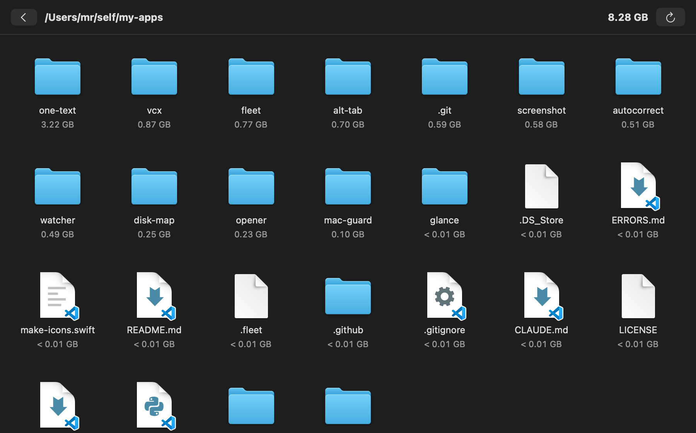

# disk-map

What fills the disk. Every folder and file of the current folder as an icon, its name under it and its weight in
GB, heaviest first.

It opens on `/` and weighs the whole startup disk in the background (the count of files read shows at the top
right); a folder shows `…` until its weight is known. A click on a folder opens it, a click on a file opens it in its
app, ⌘↑ or the arrow goes back up. Right click: Open, Show in Finder, Delete… (Move to Trash, or Delete
Permanently, after a confirmation). The arrow at the top right weighs the disk again.

The weights are kept in `~/Library/Application Support/Disk Map/sizes.tsv` with the last FSEvents event seen. At
the next launch they show at once, and only the folders changed since that event are weighed again; while the app
runs it follows the changes live.

The weight is the space taken on disk, as `du` counts it: a hard-linked file counts once, a symbolic link is not
followed. It stays on the startup disk: `/Volumes` (other disks, mounts) and `/System/Volumes` (the same data seen a
second time through its firmlinks) show "not scanned". Without Full Disk Access (System Settings → Privacy &
Security), the folders macOS protects (Mail, Messages, Safari…) count as empty.

    ./install.sh                                # builds, checks and copies Disk Map.app to ~/apps
    .build/debug/disk-map --selftest            # weighs a fixture tree, opens, deletes, goes up
    .build/debug/disk-map --render <dir> x.png  # the window for <dir>, drawn without showing it
