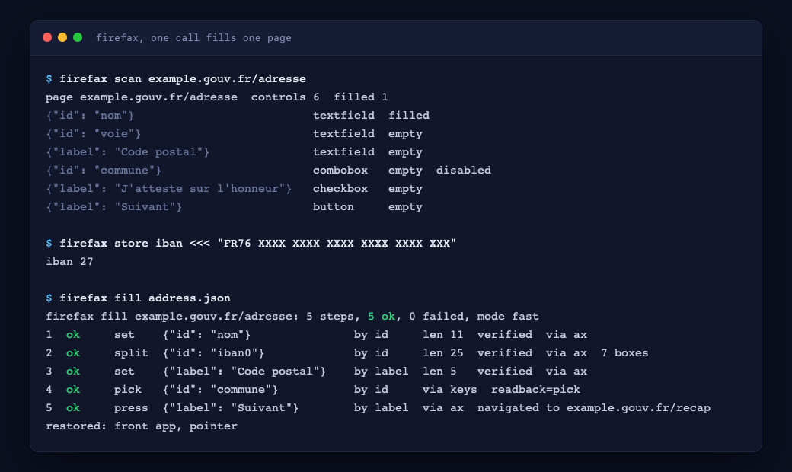

# firefax

Fill one web-form page in your already logged-in Firefox, in one call, through macOS Accessibility.
No headless browser, no second login, no automation that a bank or a government site can tell from a
real one, because it is the real one: your window, your session, the keys and the clicks a person makes.



One page, one call. You scan the page into locators, write a small JSON spec, and firefax resolves
each locator live, types or picks the value, reads it back, and stops at the first step that does not
take. It never submits on its own: a committing button needs `--final`.

## Commands

| Command | Does |
|---|---|
| `firefax scan [host/path]` | list the page's controls as ready-to-paste locators (never their values) |
| `firefax fill <file\|->` | fill the page from a JSON spec on that file or on stdin |
| `firefax store <name>` | read a value from stdin into keychain `com.mr.firefax` (prints the name and its length only) |
| `firefax refs` | list the stored ref names and their lengths |
| `firefax unlock <host>` | clear a host's challenge lock, once you have solved the captcha yourself |
| `firefax --selftest` | run the checks against an in-memory fake tree (no window, no keychain, no clock) |
| `firefax --help`, `--version` | |

Flags on `fill`: `--dry-run` (resolve every locator, write nothing), `--human` (type literal values as
keys at a human cadence, slower, off by default), `--final '<label>'` (allow one committing button or
attestation box, repeatable), `--timing` (per-step milliseconds to stderr).

## Spec

```json
{
  "page": "example.gouv.fr/adresse",
  "steps": [
    {"label": "Nom du titulaire", "set": "DUPONT MARIE"},
    {"id": "iban0", "split": {"ref": "iban"}, "prefix": "FR"},
    {"label": "Code postal", "set": "75001"},
    {"id": "commune", "type": "paris", "pick": "PARIS 1ER"},
    {"label": "J'atteste sur l'honneur", "check": true},
    {"label": "Suivant", "press": true}
  ]
}
```

A step is one locator and one action.

- locator: `id`, `label`, `placeholder` or `after` (the text before the field), plus `nth` for a tie.
- action: `set` a value, `split` a value across adjacent boxes (an IBAN, a phone), `pick` an option from
  an autocomplete list (with `type` to narrow it first), `select` a native dropdown, `check` true/false,
  `press` a button.
- value: a literal, `{"ref": "name"}` (from the keychain), or `{"file": "/path"}` (one short line, mode
  0600, not a symlink). A shaped identity number (IBAN, SIREN/SIRET, NIR, card) is refused as a literal:
  it must be a ref or a file, so no account number ever sits in a spec or a shell history.

## Exit codes

| Code | Meaning |
|---|---|
| 0 | every step ok |
| 1 | a step failed (a value did not read back, an option was missing) |
| 2 | bad spec (unknown key, two actions in a step, a press that is not last) |
| 3 | the page or its web area is not there (wrong tab, session expired, a redirect mid-run) |
| 4 | refused (a shaped literal, a password or code field, a committing button without `--final`, the hourly navigation cap) |
| 5 | a challenge or rate-limit wall (captcha, Cloudflare, "too many requests"), or a host still locked by one |

## Safety

- It refuses password, code, PIN, OTP, cryptogramme and captcha fields: those are yours to type.
- It never presses a committing button or ticks an attestation box without `--final '<label>'`, and the
  allowlisted navigation buttons (Suivant, Continuer, Next) only move between steps of the same form.
- Before every step it checks it is still the same window, pid and web area, on the same host and path;
  a redirect, an expiry or a challenge stops the run.
- At most 20 navigating presses per host per hour, kept in a small state file under
  `~/Library/Application Support/firefax/` (host names and timestamps only).
- A challenge locks its host for an hour in the same file: every later call to it exits 5 before any
  accessibility work, saying how many minutes are left, until it expires or `firefax unlock <host>`.
  "Session expirée" exits 3 and locks nothing.
- The report is one line per step and never prints a field value. A failed `pick` is the only place
  option labels appear, and they pass a word allowlist that keeps 5-digit postal codes and turns any
  other digit token into its length.
- Keyboard events are posted only when the machine has been idle 2 seconds, with the target focused and
  Firefox frontmost, checked before each key; the previously front app is restored on every exit path.

```sh
./install.sh   # builds, runs the self-test, copies to ~/.local/bin/firefax
```

`firefax --selftest` runs the whole engine (spec parsing, the value rules, matching, the pollers, the
rails, the report) against an in-memory fake tree with an injected clock, keychain and file reader, so
it touches no real window, keychain, time or file. `docs/make-demo.sh` renders the picture above from
`docs/report.html` with headless WebKit.
