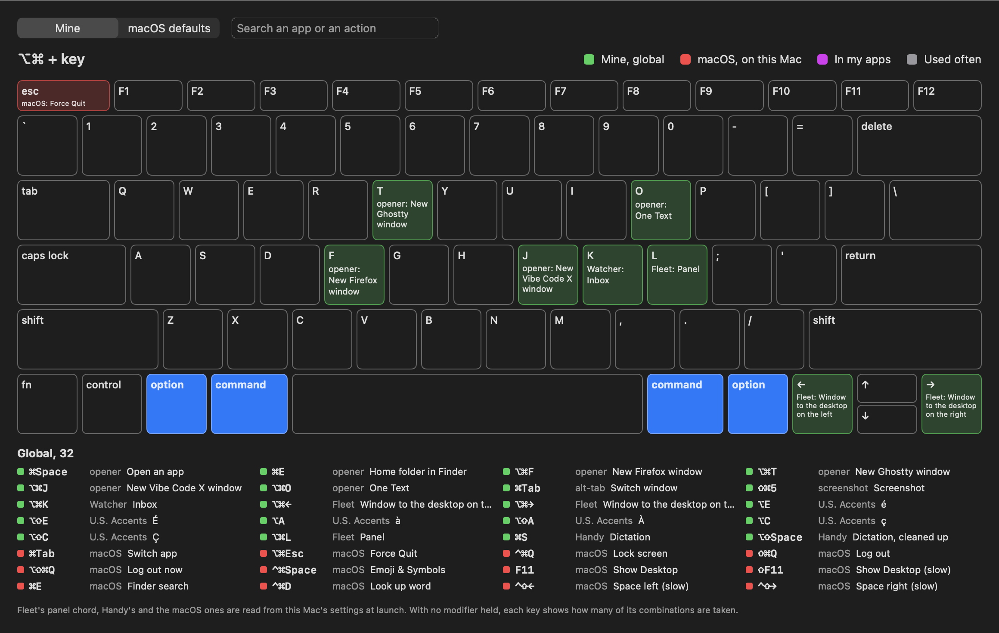

# keymap

A keyboard showing which shortcuts are taken, for the modifiers you hold or click, in two tabs.

**Mine**: my global hotkeys first (green: opener, alt-tab, screenshot, Watcher, Fleet, Handy, the U.S. Accents
layout), then the macOS ones still on on this Mac (red), the shortcuts inside my apps (purple: One Text, Vibe Code
X, Fleet's panel, Disk Map, screenshot's bar, Ghostty's ⌥C) and a few I use often (grey). The search finds an app
or an action and shows all of its shortcuts, on the keyboard and in the list under it. The macOS ones come from
System Settings' Keyboard Shortcuts (`com.apple.symbolichotkeys`), Fleet's panel chord and Handy's from their
settings, read at launch; the rest is written in `main.swift` from each app's code.

**macOS defaults**: every default shortcut of macOS 26 on a U.S. layout. Red: macOS, in every app. Orange: the
menus most apps share. Blue: text fields. A click on a shortcut strikes it out and counts it as free (one you give
up); the menu items few people use (⌘E, ⌘J, ⌘;, ⌥⌘C/V, the Finder folders on ⇧⌘) start out struck.

A click on a colour in the top right hides or shows its shortcuts; with no modifier, each key says how many of its
combinations are taken. The tab, the colours and the struck shortcuts are kept.

    ./install.sh                                # builds, checks and copies Keymap.app to ~/apps
    .build/debug/keymap --selftest              # every listed key is on the keyboard, no combination twice
    .build/debug/keymap --render x.png ⌥⌘ --tab 0 --search fleet  # drawn without showing it
