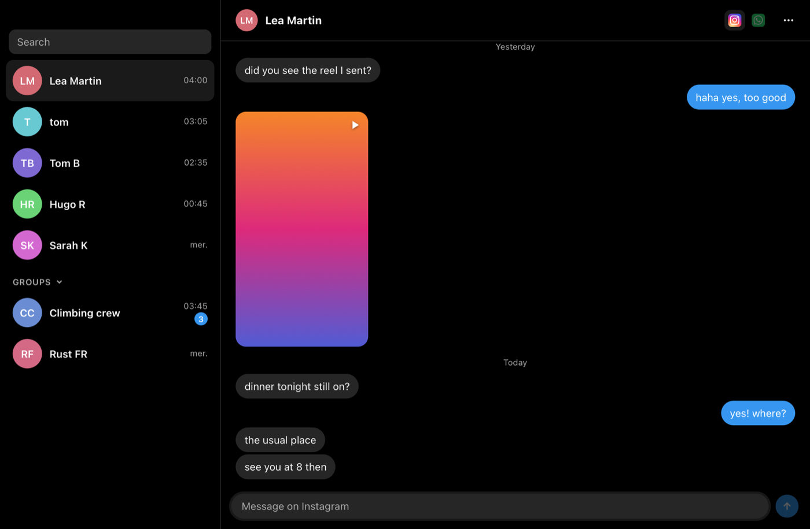

# one-text

One conversation per person, whatever app they wrote from: WhatsApp, Instagram, Discord, Teams, LinkedIn, SMS and Matrix, merged into one timeline.

It reads and sends through the local [Beeper](https://www.beeper.com) Server API (its address and token come from `~/.beeper/targets/background.json` at launch; nothing is stored in the app), and starts Beeper Server when it is not answering.

- One list, people and groups together, newest first: as many as fit in the window (10 at most, fewer under many favorites), plus anyone with unread messages; scrolling past the end shows twice as many.
- A conversation opens on its last messages; scrolling up loads older ones, a page at a time from each app, kept in time order.
- ⌘F finds a word in the open conversation (case and accents aside): ↵ goes to the older match, loading older messages past the last one, ⇧↵ to the newer; esc closes. Over a row or a favorite, ⌘F still adds or removes the favorite.
- Voice messages play in the thread, their length shown before you play them and a dot on those you have not heard to the end; stickers show as pictures. The mic button beside send records one: click it again to send, esc to drop (macOS asks once for the microphone). ⌘V on an image (a screenshot, a copied picture) sends it at once; the text in the field stays.
- Under your last message: Sent, then Seen and its time once they read it (in a group, Seen by how many).
- Hovering a message shows your 5 most used reactions beside it: click one to react, click your reaction under the message to take it back. The + at the end of that bar opens every emoji, 5 to a row, most used first: type to search them by name, ↵ picks the first.
- Right-click a message: Reply, React…, Copy; on yours, Edit (its text fills the field, ↵ saves, esc cancels) and Delete (a second click: it goes for everyone).
- ⌘R replies to the message under the pointer (or to their last one), on its app; esc cancels. A reply shows the message it answers above it, behind a white line (in a group, with who wrote it).
- `:` and two letters list emoji by name (`:joy` → 😂), the emoji on the right: ↑ ↓ to pick, ↵ or tab to put it in.
- ⌘M (or right-click → Alias…) gives a person or a group an alias, shown in place of the apps' name; ⌘D finds them by either name and shows both. In the ⌘D search, ⌘M aliases the highlighted row.
- A group can be hidden from the list (right-click, Hide from the list); ⌘D still finds it. Right-click → Merge with… makes two group chats one conversation (the same group on two apps); Split takes one back out.
- Right-click → Mute mutes a person or a group on every app it is on: no badge, no count, a bell struck out beside the name. A group chat shows the small logo of the app it comes from, then up to 4 of its members' pictures in one round tile (the picture their person has, yours or another app's, first); a person shows the logo of the app of their latest message, then their picture.
- Favorites sit above it as pictures only: right-click a person (or ⌘F over them, or on the highlighted row of the ⌘D search) to add or remove one. A pinned group keeps its row, under those pictures, with all its members overlapping left to right. ⌘ + arrows move the favorite under the pointer (or the open one) to order them. Favorites in no group sit on top; under them, each group you make (+ New group) is always open, its name above its pictures; the sidebar fits 5 pictures to a row. A group of more than 5 shows 4 and folds the rest into one tile of small pictures (click it to unfold); whoever has unread messages stays out of the tile, unless 5 or more do. Someone is in one group at most: drag them onto another group to move them, or onto the top strip to take them out (right-click → Move to <group> does the same). Thin white lines separate favorites, groups, pinned group chats and the list.
- Chats with the same name (word order and accents aside), the same phone number, an Instagram handle like `first.last` matching a full name, or `first_l` matching the one full name that starts that way, are one person; so is a first name alone ("Cyprien") when no app has two chats under it; and so are the chats inside one Beeper merged itself, and two chats under the same first name on two apps with the same profile photo (however each app crops it: Instagram gives no phone number to meet WhatsApp on); the ⋯ menu merges or splits them by hand.
- A click on the picture in the conversation's header, or on the open conversation's picture in the list (a group's bubble of faces), opens their profile from the right: what each app knows of them (name, username, phone, email); for a group, its description and members, admins first, each opening their own profile; Merge with… there makes them one with another person or group. esc closes it.
- The logos at the top right are the apps that person is on; the highlighted one is where your reply goes (by default the app they last wrote from). Click another, or type `/ws`, `/ig`, `/dc`, `/te`, `/li`, `/sm` or `/mx`.
- Right-click → Change picture… gives a person or a group a picture of your own (kept in the app's `overrides.json`).
- `"openAtLaunch": "<chat id>"` in `overrides.json` opens that conversation at launch.
- A reaction to one of your messages does not count as unread, and a muted chat shows no count.
- A badge stays until you answer (here or on the app, a reaction included) or press ⌘K for "seen, nothing to say" (over a row, or on the open one); both send the read receipt. Opening a conversation sends it on every app but Instagram, as the apps themselves do.
- It opens at login, and ⌘Q or the close button only hide it, unless Allow Quitting is ticked in the One Text menu.
- Drag the sidebar's right edge to widen or narrow it; the width is kept.
- ⌘D opens a search over everyone in the middle of the window: ↑ ↓ to pick, ↵ to open, esc to close. `/discord`, `/whatsapp` (or `/dc`, `/wh`…) before a name keeps only those on that app.

## Build

    cd src-tauri && npx @tauri-apps/cli build --bundles app

## Checking it without a window

`node tests/ui.mjs <outdir>` runs the interface in headless WebKit on made-up chats, checks it, and writes screenshots.
