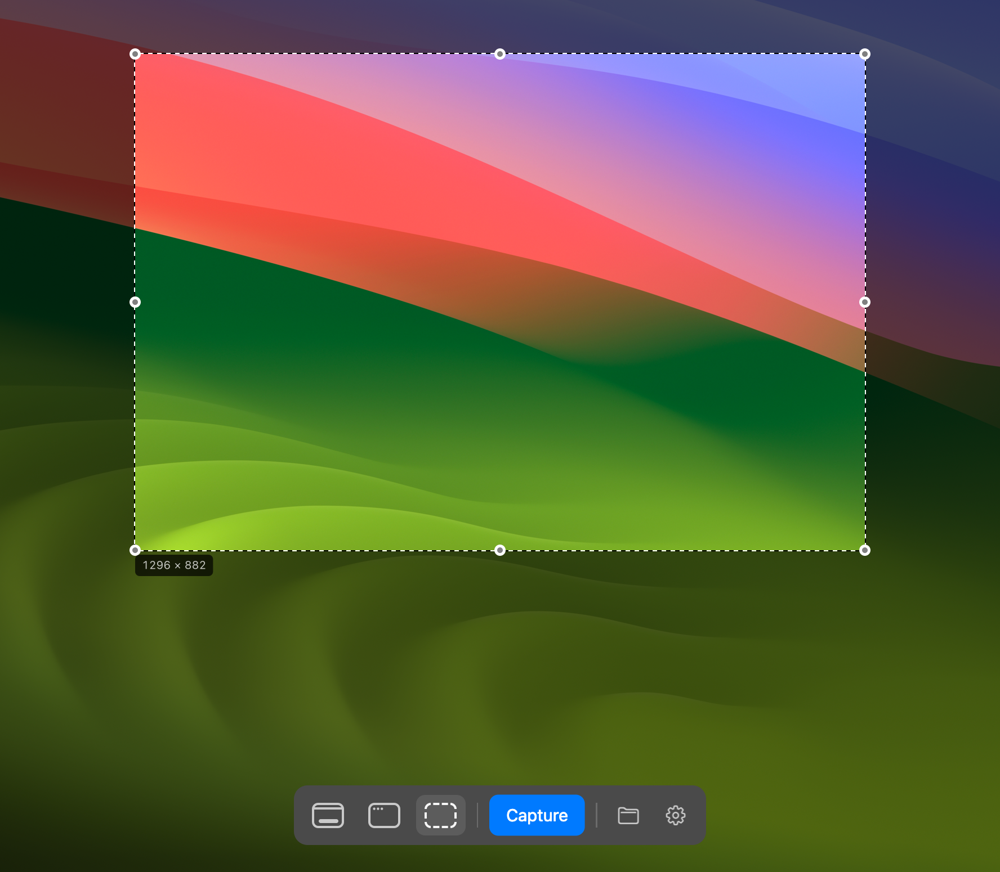
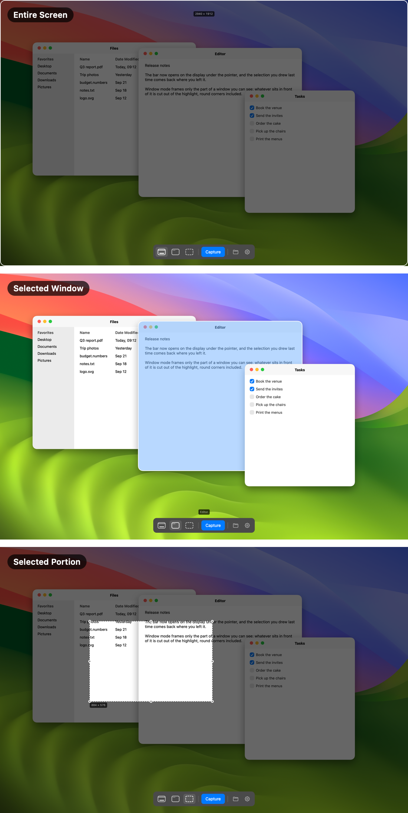
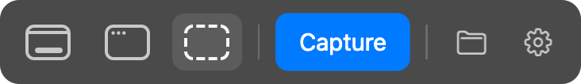
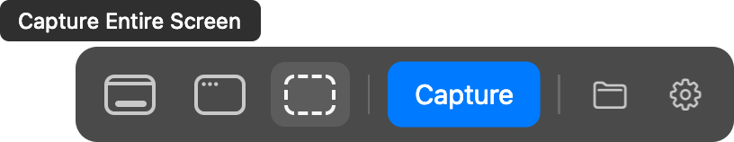
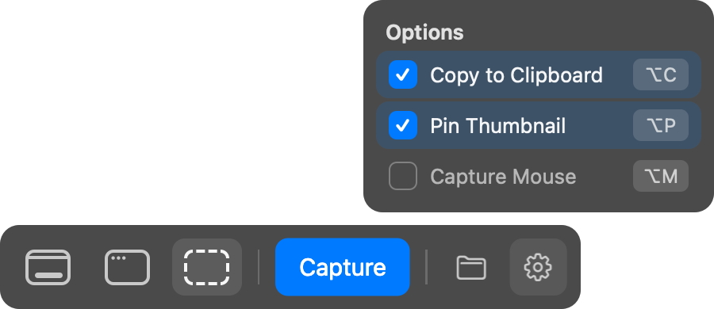
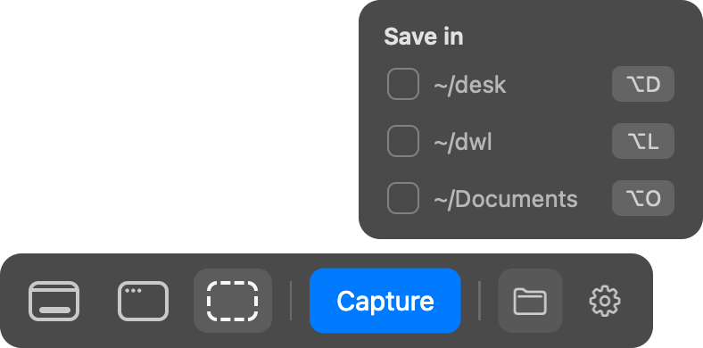

# screenshot

A ⌘⇧5 replacement for macOS, for stills only: the same bar, the same three modes, every setting
in view, and a file that is on disk the moment you click, not five seconds later.




Press ⌘⇧5. The screen freezes and dims, the bar comes up at the bottom, and you pick what to
take: the entire screen, a window, or a portion you drag out.



- **Entire Screen** — everything stays dimmed, framed in white along the display's round corners.
- **Selected Window** — no dimming: the window under the pointer turns light blue in a white
  frame, and the highlight stops where another window sits in front of it.
- **Selected Portion** — the screen is dimmed except the box you drag, with its handles and its
  size in pixels.



Hovering a button names its mode, with none of a tooltip's delay:



- **Keys.** ⌘← ⌘→ step through the modes, the arrows glide the selection by 20 (⇧ by 100, ⌥ resizes),
  Return takes it, Escape, a right click or ⌘⇧5 again closes.
- **Settings.** Right of Capture, a folder icon holds **Save in** (Desktop, Downloads, Documents;
  several at once) and a gear holds **Options** (Copy to Clipboard, Pin Thumbnail, Capture Mouse).
  Hovered, each lets its settings rise and fade in above it; a click, or ⌥ and the letter shown
  on its row (⌥D, ⌥L, ⌥O, ⌥C, ⌥P, ⌥M), flips one.

  

  

- **After the shot.** A thumbnail sits in the corner for eight seconds: a click pins it, a drag
  takes the file with it.
  A pinned capture stays in the top-right corner: a click copies it, a double click opens the
  file, a right click unpins it.
- **Nothing in the menu bar.** It runs as a LaunchAgent, invisible, and only answers ⌘⇧5.

The same settings are `defaults write com.mr.screenshot <key> <value>`; another folder goes
in with `defaults write com.mr.screenshot folders -array ~/desk ~/shots`.

## Install

**Download** [the latest release](https://github.com/anpawo/my-apps/releases/latest),
unzip it, and move `screenshot.app` to `~/Applications`. Apple Silicon only.

macOS will refuse to open it the first time: the release is signed ad-hoc, which is what an
app signed by nobody looks like. Open it once, then go to **System Settings → Privacy &
Security → Open Anyway**. Opened by hand it runs until you log out; building it with
`./install.sh`, below, is what makes it start at login.

## Build

Swift, Command Line Tools only — no Xcode.

```sh
./install.sh             # builds, installs to ~/apps (else ~/Applications), starts it at login
swift run -c release check
./build.sh --release     # ad-hoc and zipped: what a download is made of
```

Turn the system's own ⌘⇧5 off first: System Settings → Keyboard → Keyboard Shortcuts →
Screenshots. The app needs Screen Recording, and asks for it the first time.

The pictures above are drawn by the app's own views, offscreen, over a stock wallpaper and stand-in windows:
`.build/release/screenshot --render-docs docs`. `docs/make-demo.sh` draws the GIF the same way, frame by
frame (`--render-demo`), and puts it together with ffmpeg.
