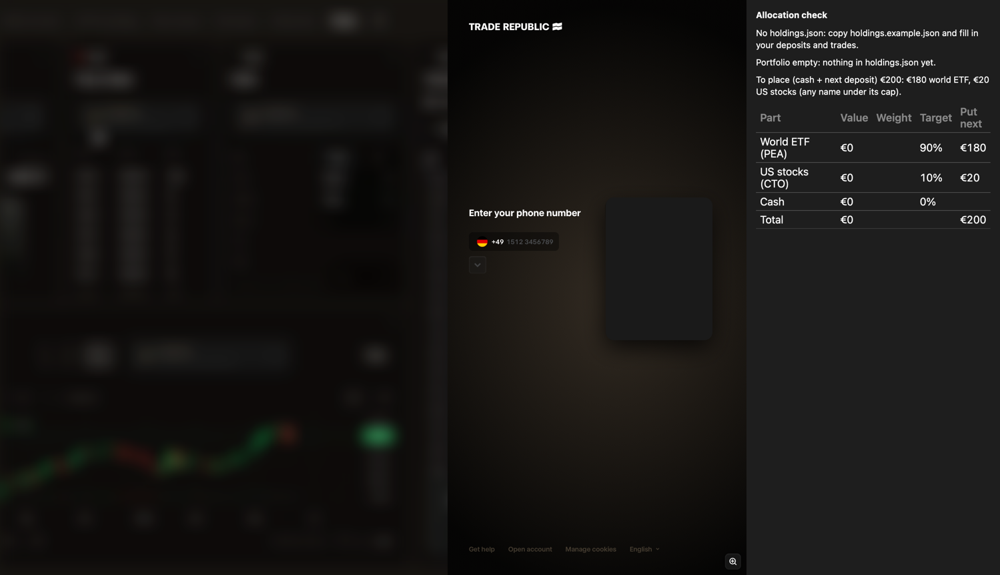

# trade

Keeps the broker web pages of a PEA (Bourse Direct) and a CTO (Trade Republic) loaded and logged in, one key
apart, with the allocation check beside them, so an order takes seconds instead of a login.



- **⌘1** Bourse Direct (PEA), **⌘2** Trade Republic (CTO), **⌘R** reloads the page, **⌘⇧H** goes back to the
  broker's home, **⌘[ ⌘]** back and forward, **⌘⇧R** runs the allocation check again (it also runs every hour).
- You log in yourself, once: the app types no password and no code, and places no order. Cookies live in the app's
  own WebKit store; every 4 minutes each page gets a mouse move and a same-origin request so the session does not
  time out. A session cookie still dies with the app: leave it open.
- The right panel is the output of `~/self/trading/finance/allocation/plan.py` (90% world ETF in the PEA, up to 10%
  US stocks in the CTO, 2% per stock, where the next deposit goes).
- A page's `alert()` and `confirm()` show as sheets, and links that open a new window open in the same tab.

```
./install.sh                       # builds, copies to ~/Applications, relaunches it if it ran
dist/Trade.app/Contents/MacOS/Trade --snapshot <dir>   # renders both pages and the panel to PNGs, no window
```
