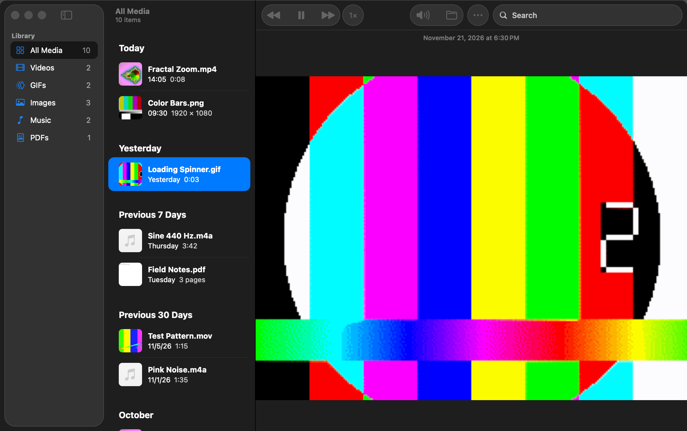

# Viewer Media

One window for images, videos, GIFs, music and PDFs: load many, switch with the arrows, change the playback speed.



Files opened from Finder, with `open` or dropped on the window join the list of the one window. A folder adds the media files inside it.

Laid out like Notes: the sidebar sorts the files by kind (videos, GIFs, images, music, PDFs) with their counts, the list groups them by modified date with a thumbnail, the duration, pixel size or page count, and the search field filters them by name. The toolbar holds the speed, play, volume and Reveal in Finder buttons.

| In the app | Anywhere | Does |
|---|---|---|
| ↑ / ↓ | ⌃⌥↑ / ⌃⌥↓ | Previous / next item, in the list's order |
| ← / → | ⌃⌥← / ⌃⌥→ | Slower / faster video or GIF (0.25× to 4×); previous / next PDF page |
| Space | ⌃⌥Space | Play / pause |
| ⌥↑ / ⌥↓ | ⌃⌥⇧↑ / ⌃⌥⇧↓ | Volume |
| ⌥← / ⌥→ | ⌃⌥⇧← / ⌃⌥⇧→ | Jump to start / end |
| ⇧← / ⇧→ | | Back / forward 5 s |
| ⌘+ / ⌘- | | Zoom an image or PDF (pinch works too) |
| ⌫ | | Remove the item from the list |
| F | | Full screen |
| ⌘, | | Settings: the file kinds it opens, and which app opens each by default |

Videos play through AVFoundation, so formats macOS cannot decode (WebM, MKV) show a crossed-out play button.

## Install

```sh
./install.sh
```
