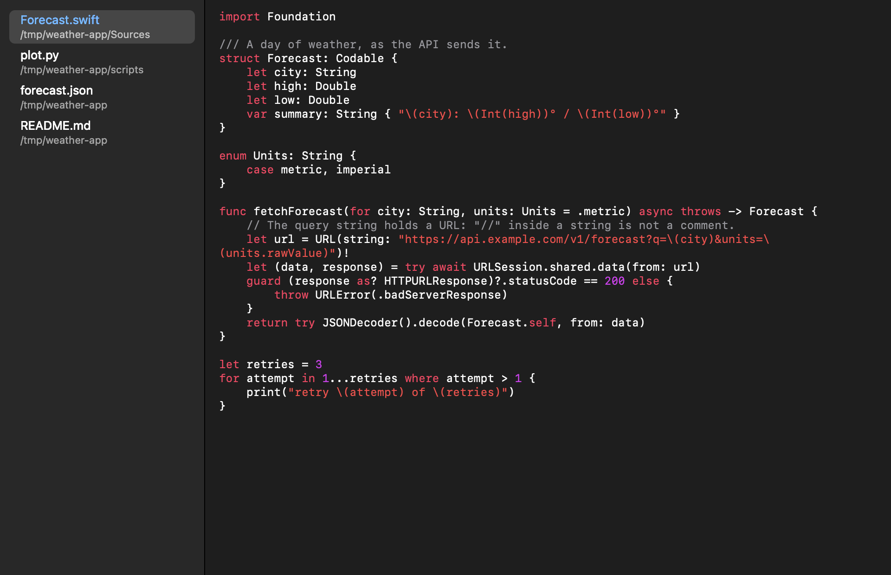

# Viewer Text

A minimal viewer and editor for text and code, with syntax coloring, made to be the default opener of every text file.



One window: the files you open line up in the sidebar, the selected one shows on the right, colored by a small regex highlighter (Swift, Python, JavaScript/TypeScript, C/C++/Objective-C, Rust, Go, Java/Kotlin, shell, Ruby, SQL, Lua, Markdown, JSON, YAML, TOML/INI, HTML/XML). A file that changes on disk reloads by itself while it has no unsaved edits, so it works as a live log viewer. Files over 2 MB open uncolored.

| Key | Does |
|---|---|
| ⌘O | Open files (or drop them on the window) |
| ⌘S | Save, in the file's own encoding |
| ⌘W | Close the current file (asks if unsaved) |
| ⌃Tab / ⌃⇧Tab | Next / previous file |
| ⌘F, ⌘G, ⌘E | Find bar, next match, find the selection |
| ⌘, | Settings: the file kinds it opens, and which app opens each by default |

## Install

```sh
./install.sh
```

It builds the app, copies it to `~/apps` (else `~/Applications`) and registers it, so it can be picked as the default app for text files; it changes no default itself. `swift run check` tests the highlighter and the file encoding.
