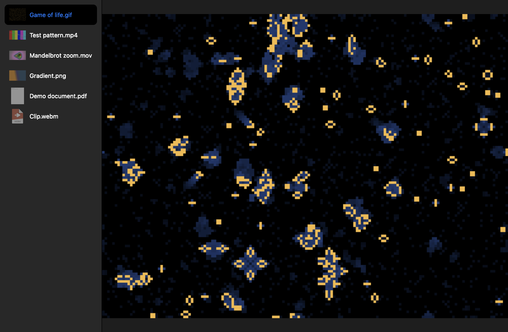

# Viewer

One window for images, videos, GIFs, music, PDFs and text or code: load many, switch with the arrows, change the playback speed, edit a text file in place.



Files opened from Finder, with `open` or dropped on the window join the list of the one window. A folder adds the files inside it that the app opens.

Laid out like Notes: the sidebar lists the files open in the window, in the order they were opened, with a thumbnail and the duration, pixel size, page count or folder, an unsaved text file with a dot; the search field filters them by name. The sidebar stays hidden until the toolbar's sidebar button shows it, as in Preview. A file open alone gives the window its shape, a portrait video a portrait window; a list keeps the viewer 16:9.

- **Media**: a video, GIF or song gets a bar over its bottom with slower, play, faster, its speed and a seek slider; the toolbar shows the volume button then, and its "…" menu holds Reveal in Finder. Videos play through AVFoundation, so formats macOS cannot decode (WebM, MKV) show a crossed-out play button.
- **Text and code**: editable, with line numbers, colored in VS Code's Dark 2026 theme by a small regex highlighter (Swift, Python, JavaScript/TypeScript, C/C++/Objective-C, Rust, Go, Java/Kotlin, shell, Ruby, SQL, Lua, Markdown, JSON, YAML, TOML/INI, HTML/XML, and CSV/TSV columns as Rainbow CSV colors them). A file that changes on disk reloads by itself while it has no unsaved edits, so it works as a live log viewer. Files over 2 MB open uncolored.

| In the app | Anywhere | Does |
|---|---|---|
| ↑ / ↓ | ⌃⌥↑ / ⌃⌥↓ | Previous / next item, in the list's order (⌃Tab / ⌃⇧Tab in a text file) |
| ← / → | ⌃⌥← / ⌃⌥→ | Slower / faster video or GIF (0.25× to 4×); previous / next PDF page |
| Space | ⌃⌥Space | Play / pause |
| ⌥↑ / ⌥↓ | ⌃⌥⇧↑ / ⌃⌥⇧↓ | Volume |
| ⌥← / ⌥→ | ⌃⌥⇧← / ⌃⌥⇧→ | Jump to start / end |
| ⇧← / ⇧→ | | Back / forward 5 s |
| ⌘+ / ⌘- | | Zoom an image or PDF (pinch works too) |
| ⌘O | | Open files or folders (or drop them on the window) |
| ⌘S | | Save a text file, in its own encoding |
| ⌘W, ⌫ | | Close the current file (asks if unsaved) |
| ⌘F, ⌘G, ⌘E | | Find bar, next match, find the selection |
| F | | Full screen |
| Esc | | Hide / show the playback bar |
| ⌘, | | Settings: the file kinds it opens, and which app opens each by default |

In a text file the keys type text, so only ⌘ and ⌃ shortcuts act.

## Install

```sh
./install.sh
```

It builds the app, copies it to `~/apps` (else `~/Applications`) and registers it, so it can be picked as the default app for each kind; it changes no default itself. `swift run check` tests the file kinds, the highlighter and the file encoding.
